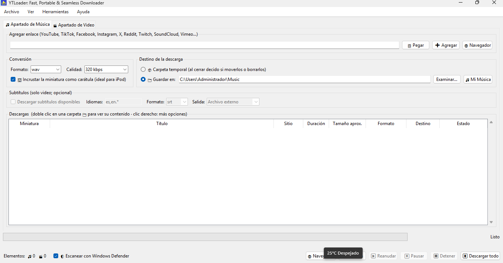
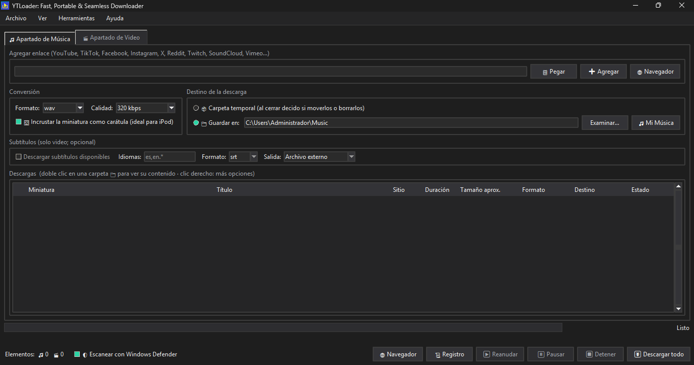
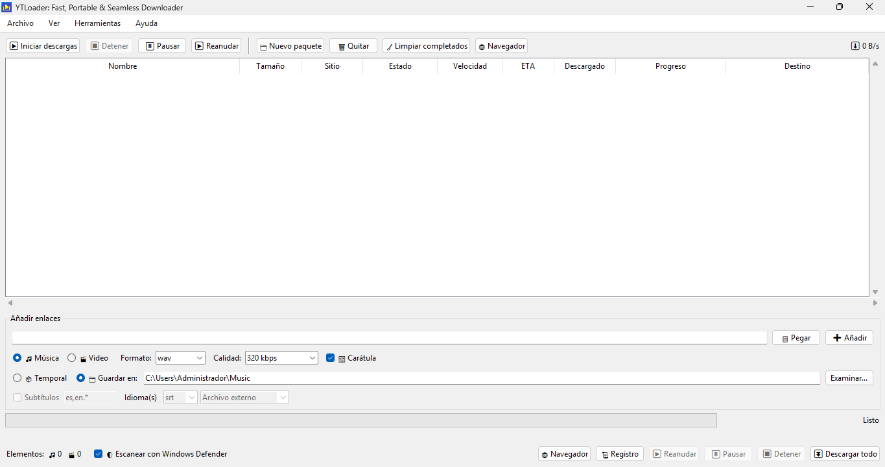

<div align="center">


# YTLoader

**Fast, Portable & Seamless Downloader**

Descargador de música y video para Windows, portable y con interfaz gráfica.

[](https://github.com/eltender1227/YTLoader-elTender1227/releases)
[](https://github.com/eltender1227/YTLoader-elTender1227/releases)
[](https://github.com/eltender1227/YTLoader-elTender1227/issues)


[Descargar](https://github.com/eltender1227/YTLoader-elTender1227/releases/latest) ·
[Reportar un error](https://github.com/eltender1227/YTLoader-elTender1227/issues/new) ·
[Ver novedades](https://github.com/eltender1227/YTLoader-elTender1227/releases) ·
[Ver el video](https://github.com/eltender1227/YTLoader-elTender1227/blob/main/YTLoader-motion.mp4)

<br>


</div>

---

## Capturas

<div align="center">

| Modo claro | Modo oscuro | Estilo JDownloader 2 |
|:---:|:---:|:---:|
|  |  |  |

</div>

## Qué es

YTLoader usa [yt-dlp](https://github.com/yt-dlp/yt-dlp) como motor de descarga y [ffmpeg](https://ffmpeg.org/) para convertir formatos. Está hecho en Python y Tkinter. No necesita instalación obligatoria: puedes llevarlo en una carpeta o en una memoria USB.

## Características

| Área | Qué ofrece |
|---|---|
| **Descarga** | Apartados separados de música y video. Enlaces sueltos y playlists, con miniatura, título, tamaño y duración antes de descargar. |
| **Formatos** | Audio en MP3, WAV y otros. Video en MP4, MKV, MOV y otros. Carátula incrustada en la música. |
| **Organización** | Las playlists se guardan como carpetas. Paquetes, mover y renombrar. |
| **Control** | Descargas en segundo plano con pausa, reanudación y cancelación, con borrado de parciales. |
| **Cortador de clips** | Quita la intro o el final desde un archivo local o desde una URL, y recorta también los subtítulos. |
| **Seguridad** | Escaneo de cada descarga con Windows Defender. |
| **Apariencia** | Modo claro y oscuro, varios temas y una vista al estilo JDownloader 2. |
| **Monitoreo** | Ventana de registro, gráficas de velocidad y disco. |
| **Actualizaciones** | Botón para actualizar yt-dlp y buscador de nuevas versiones de YTLoader. |

## Instalación

1. Ve a [Releases](https://github.com/eltender1227/YTLoader-elTender1227/releases/latest).
2. Descarga `Setup.exe` y ejecútalo.
3. Abre YTLoader desde el escritorio o el menú Inicio.

> [!NOTE]
> Windows SmartScreen puede mostrar una advertencia porque el instalador aún no está firmado digitalmente. Pulsa "Más información" y luego "Ejecutar de todos modos".

## Requisitos

- Windows 10 u 11.
- `yt-dlp.exe` junto al programa.
- `ffmpeg.exe` para convertir formatos.
- `deno.exe` junto a `yt-dlp.exe`, necesario para YouTube en versiones recientes de yt-dlp.

## Ejecutar desde el código fuente

```bash
pip install pillow psutil pystray opencv-python moviepy
python YTLoader.pyw
```

Las librerías son opcionales: sin ellas se desactivan las miniaturas, las gráficas de disco o el cortador de clips, según corresponda.

## Uso rápido

1. Elige la pestaña de **Música** o **Video**.
2. Pega uno o varios enlaces.
3. Elige formato y carpeta de destino.
4. Pulsa descargar.

## Actualizaciones

YTLoader consulta la última release de este repositorio al abrir y desde **Ayuda → Buscar actualizaciones de YTLoader**.

## Contribuir

Los reportes de errores y las ideas son bienvenidos en [Issues](https://github.com/eltender1227/YTLoader-elTender1227/issues). Si reportas un error, incluye tu versión de Windows, la versión de YTLoader y el contenido de `error_log.txt`.

## Aviso legal

Usa esta herramienta solo para contenido que tengas derecho a descargar. Respeta los términos de servicio de cada plataforma y las leyes de derechos de autor de tu país.

<div align="center">

Hecho con Python y Tkinter por [eltender1227](https://github.com/eltender1227)

</div>
